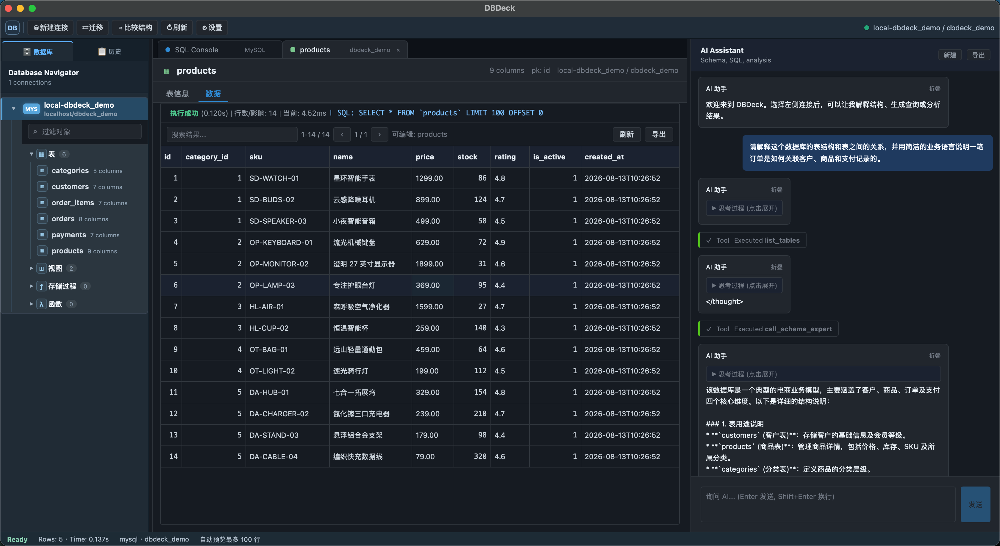

# DBDeck (multi-source desktop edition)

[简体中文](README.md) | **English**

A desktop database workbench built on FastAPI + Vue 3 + pywebview, with an integrated LLM and a plug-in structure organized by data source type. MySQL, PostgreSQL, SQLite, MongoDB and Redis each provide their own connection implementation, query syntax, prompts, AI tool set and editor completion rules.

## Screenshot



Browse database objects and table data in one desktop workbench, and use the AI assistant to understand schemas, write queries and analyze results.

## Features

- **Multiple data sources**: manage MySQL / PostgreSQL / SQLite / MongoDB / Redis connections in a tree view
- **SSH tunnels for network sources**: MySQL / PostgreSQL / MongoDB / Redis can reach internal services through an SSH jump host
- **Natural-language queries**: the AI picks the tool set that matches the current data source type
- **Data analysis**: trend, anomaly and insight analysis of query results (works for every data source)
- **Schema explanation**: MySQL / PostgreSQL / SQLite / MongoDB use their own schema-expert prompts, distinguishing SQL table structures from MongoDB document structures
- **Write confirmation**: before the AI runs a write or destructive command, it shows the tool arguments and waits for your approval
- **Smart editor**: Monaco editor; language and column completion rules come from the current data source provider
- **Queries and results**: multi-statement execution, result pagination, and export to CSV / JSON / XLSX / SQL INSERT / Markdown
- **Result editing**: edit MySQL / PostgreSQL / SQLite query results whose primary key can be identified safely, and MongoDB documents that include `_id`
- **Table migration**: copy table structure and data between MySQL and SQLite; migrations across SQL dialects may need manual DDL adjustments
- **Database tools**: SQL table structure comparison, query history, MySQL / PostgreSQL session management, and MySQL / SQLite SQL backups
- **Desktop workbench**: toolbar, database navigator, SQL console, results panel, AI panel and status bar
- **Desktop launch**: pywebview opens a local window; the FastAPI backend runs on a local port automatically
- **Chinese / English interface**: choose "System default", 中文 or English under Settings → General → Interface language. The default follows the operating-system language (Chinese on a Chinese system, English otherwise), and your choice is saved in the local configuration

## Architecture concept: SourceProvider

Each data source type has one provider on the backend and one on the frontend. Shared connection, query, editor and AI flows work through a common interface; database-specific features such as result editing and session management still keep the dialect branches they need.

The backend `SourceProvider` exposes:
- `create_client(config)`: the connection object (implements `execute` / `get_schema`)
- `tools()`: the tool set this provider exposes to the LLM (its own `ToolRegistry`)
- `system_prompt(session_ctx)`: the system prompt for the current data source
- `capabilities`: declares DDL, migration, execution plan, backup, query language, data model and similar capabilities

The frontend provider (`web_ui/js/sources/*.js`) exposes:
- `editorLanguage` / `registerCompletion(monaco, ctx)`
- `buildSelectQuery / buildInsertQuery / buildPreviewQuery`
- `connFormFields`: connection form fields (rendered dynamically)
- `capabilities`: lets the UI enable migration, execution plans, backups and so on per data source

## Project layout

```
src/
├── main.py                            # Entry point: registers sources and starts FastAPI
├── api/                               # HTTP route aggregation and per-feature routers
│   ├── routes.py                      # Only aggregates sub-routers
│   ├── source_routes.py / query_routes.py / ai_routes.py
│   └── config_routes.py / migration_routes.py / data_edit_routes.py
├── services/                          # Business services; routes hold no business logic
│   ├── source_service.py / query_service.py / ai_service.py
│   └── config_service.py / migration_service.py / data_edit_service.py
├── common/
│   ├── config.py
│   ├── i18n.py                        # Language of messages returned to the UI (msg(zh, en))
│   ├── storage.py                     # SQLite (config.db): data sources, scripts, system settings
│   └── sql_utils.py                   # add_limit_to_select / serialize_row, etc.
├── ai_core/
│   ├── agent.py                       # Generic ReAct loop (no isinstance checks, no SQL allow-list)
│   ├── tools/
│   │   └── registry.py                # Tool / ToolRegistry / @registry.tool
│   └── shared_tools/
│       ├── analyzer.py + analyzer.md  # Data-agnostic analysis sub-agent shared by all built-in providers
│       └── __init__.py
└── sources/                            # ★ One directory per data source type
    ├── base.py                         # SourceProvider / DataSourceClient / Capabilities
    ├── registry.py                     # register / get_provider
    ├── connection_manager.py           # Caches connections by source_id + config signature
    ├── operation_policy.py             # read/write/destructive/unknown operation classification
    ├── __init__.py                     # Registers all built-in providers
    ├── mysql/
    │   ├── provider.py / client.py / tools.py
    │   └── prompts/system.md, schema_expert.md
    ├── sqlite/
    │   ├── provider.py / client.py / tools.py
    │   └── prompts/system.md, schema_expert.md
    ├── postgresql/
    │   ├── provider.py / client.py / tools.py
    │   └── prompts/system.md, schema_expert.md
    ├── mongodb/
    │   ├── provider.py / client.py / tools.py
    │   └── prompts/system.md, schema_expert.md
    └── redis/
        ├── provider.py / client.py / tools.py
        └── prompts/system.md

web_ui/
├── index.html
├── css/style.css
└── js/
    ├── app.js
    ├── api.js
    ├── i18n/                           # UI text: zh.js / en.js dictionaries + t() and language switching
    ├── state/                          # Frontend state composables (notifications, AI session, ...)
    ├── sources/                        # ★ Frontend providers
    │   ├── base.js / registry.js
    │   ├── mysql.js / postgresql.js / sqlite.js / mongodb.js / redis.js
    └── components/
        ├── SourceTree.js / SqlEditor.js / ResultArea.js / AiPanel.js / Modals.js
```

## AI tools (per data source)

| Provider | Tools | Notes |
|---|---|---|
| MySQL | `list_tables` / `describe_table` / `get_db_schema` / `execute_sql` / `show_create_table` / `explain_sql` / `call_schema_expert` / `call_analyzer` | EXPLAIN + SHOW CREATE TABLE |
| PostgreSQL | `list_tables` / `describe_table` / `get_db_schema` / `execute_sql` / `show_create_table` / `explain_sql` / `call_schema_expert` / `call_analyzer` | PostgreSQL dialect + EXPLAIN + DDL |
| SQLite | `list_tables` / `describe_table` / `get_db_schema` / `execute_sql` / `show_create_table` / `explain_sql` / `call_schema_expert` / `call_analyzer` | EXPLAIN QUERY PLAN; DDL read from `sqlite_master` |
| MongoDB | `list_collections` / `describe_collection` / `sample_documents` / `execute_mongo_query` / `call_schema_expert` / `call_analyzer` | No DDL/EXPLAIN |
| Redis | `list_keys` / `describe_key` / `sample_key` / `execute_redis_command` / `call_analyzer` | redis-cli style commands; preview by key type |

Every built-in provider registers the data-agnostic `call_analyzer`. MySQL, PostgreSQL, SQLite and MongoDB also provide their own `call_schema_expert`; Redis has no schema explanation tool.

## Adding a new data source type (developer guide)

1. Under `src/sources/<your-type>/`, create:
   - `client.py`: implements `DataSourceClient` (`execute` / `get_schema` / `close`)
   - `tools.py`: a `ToolRegistry()` instance plus `@reg.tool(...)` tools; call `register_analyzer(reg)` to include the shared analysis tool
   - `prompts/system.md`: the system prompt for the data source
   - `provider.py`: implements `SourceProvider` and declares `id` / `display_name` / `capabilities`
2. Call `register_provider(YourProvider())` in `src/sources/__init__.py`
3. Frontend `web_ui/js/sources/<your-type>.js`: export `id` / `editorLanguage` / `connFormFields` / `registerCompletion` / `buildSelectQuery` / `buildInsertQuery` / `buildPreviewQuery` / `capabilities`
4. Register it in `web_ui/js/sources/registry.js`
5. Add the read/write/destructive classification rules for the data source to `src/sources/operation_policy.py`
6. Add tests for the provider registry, operation classification and connection/query paths

Basic connections, queries and AI tools usually need no changes to shared routes or the agent. Special capabilities such as result editing, migration or backup also need the matching service and UI logic.

## Running from source

Requirements: Python 3.10+. Use a project virtual environment rather than installing dependencies into the global Python.

Create the virtual environment:

```bash
python -m venv venv
```

Activate it:

```bash
# macOS / Linux
source venv/bin/activate

# Windows (Command Prompt)
venv\Scripts\activate.bat

# Windows (PowerShell)
venv\Scripts\Activate.ps1
```

Then install the dependencies:

```bash
python -m pip install -r requirements.txt
```

Start the desktop app:

```bash
python -m src.desktop
```

Start only the web service:

```bash
python -m src.main
```

Both modes look for a free port starting at `31415`. In web service mode, open [http://localhost:31415](http://localhost:31415). The service listens only on the loopback address and must not be exposed to a LAN or the internet through a reverse proxy. Use `--port` to choose a preferred port, e.g. `python -m src.main --port 9000` or `python -m src.desktop --port 32000`.

Windows 10/11 usually ships the Microsoft Edge WebView2 Runtime that pywebview needs. If the desktop window cannot be created, install or repair the WebView2 Runtime first.

## Packaging the desktop app

PyInstaller must run on the target operating system: build the `.app` on macOS and the `.exe` on Windows. Cross-building a Windows program on macOS is not supported.

### macOS

On macOS you can double-click `package.command` in the project root. The script installs the dependencies and packages the project as:

```text
dist/DBDeck.app
```

You can also run it from a terminal:

```bash
./package.command
```

### Windows

On Windows, double-click `package-windows.bat`, or run it from the Command Prompt:

```bat
.\package-windows.bat
```

The script creates a virtual environment, installs the dependencies from `requirements-build.txt` and packages the app with PyInstaller. The output is:

```text
dist\DBDeck.exe
```

Windows uses PyInstaller's `onefile` mode, so you only need to distribute `dist\DBDeck.exe`. The packaged app stores user settings in `%LOCALAPPDATA%\DBDeck\config.db`.

## LLM settings and local storage

LLM parameters can be put in `.env` or saved to `config.db` from the in-app Settings. When both are set, the in-app setting wins. Database connections are created in the UI.

### Credential storage and config export

This is a desktop tool for a local, single-user environment. Connection passwords, SSH passwords/private key contents, the LLM API key, saved queries and query history are stored in the local `config.db` SQLite file without application-level encryption. Config exports contain these values too.

- Rely on operating-system accounts and file permissions to protect the project directory and `config.db`.
- Do not commit `config.db`, `.env` or config exports that contain credentials to Git, and do not send them to others.
- After using a shared computer, delete your connections, clear the history and remove the config file.

### LLM settings (also available in Settings)
- `LLM_API_KEY`
- `LLM_MODEL` (e.g. gpt-4o)
- `LLM_API_BASE`
- `LLM_TEMPERATURE`
- `LLM_MAX_TOKENS`

## Development notes

- **Frontend**: native ES modules, no `npm install`. Browser dependencies (Vue, Element Plus, Monaco, sql-formatter, SheetJS, Chart.js) are pinned and vendored in `web_ui/vendor/`, loaded locally and usable offline
- **UI text and languages**: all UI text lives in `web_ui/js/i18n/zh.js` and `en.js` (both dictionaries must have the same keys; `tests/js/i18n.test.mjs` checks this). Use `$t('key')` in templates; in JS, `import { t } from './i18n/index.js'` and call `t('key', { params })`. Messages the backend returns to the UI use `msg(Chinese, English)` from `src/common/i18n.py`, with the language taken from the frontend's `X-DBDeck-Language` request header; logs and prompts sent to the LLM are not translated
- **AI event stream**: NDJSON; the frontend handles `delta` / `tool_start` / `tool_end` / `confirm_required` / `final` / `error` events
- **Editing prompts**: edit `src/sources/<type>/prompts/*.md` and restart the service
- **Switching data sources**: the agent resets its history when the provider changes (so MySQL context does not leak into a Mongo conversation)
- **Product readiness check**: run `./venv/bin/python scripts/check_product_ready.py`
- **Frontend tests**: `node --test tests/js/*.mjs` (needs a Node.js that detects `web_ui/js/*.js` as ES modules automatically; verified on 20.19 and 24, older releases such as 16 and 22.2 fail)
- **Architecture audit**: see [docs/ARCHITECTURE_AUDIT.md](docs/ARCHITECTURE_AUDIT.md)

## AI data and privacy

When AI features are enabled, your questions, database schema context, query text and tool results may be sent to the configured LLM service. Check that service's data retention and training policies first, and do not enable AI on databases you are not authorized to share. The project provides no shell command execution tool.

## Security and contributing

- See [SECURITY.md](SECURITY.md) for the security model and how to report vulnerabilities.
- See [CONTRIBUTING.md](CONTRIBUTING.md) for development and contribution guidelines, and [CODE_OF_CONDUCT.md](CODE_OF_CONDUCT.md) for the code of conduct.
- See [THIRD_PARTY_NOTICES.md](THIRD_PARTY_NOTICES.md) for third-party browser components.

## License

This project is licensed under the [MIT License](LICENSE).
