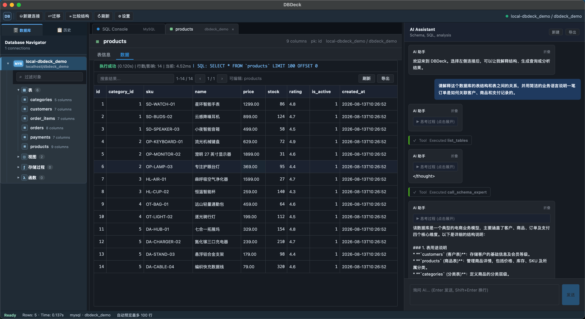

# DBDeck（多数据源桌面版）

基于 FastAPI + Vue 3 + pywebview 的桌面数据库工作台，集成 LLM，按“数据源类型”插件化组织。MySQL、PostgreSQL、SQLite、MongoDB 和 Redis 各自提供连接实现、查询语法、提示词、AI 工具集与前端补全规则。

## 界面预览



在同一个桌面工作台中浏览数据库对象和表数据，并通过 AI 助手理解表结构、生成查询与分析结果。

## 功能

- **多源管理**：MySQL / PostgreSQL / SQLite / MongoDB / Redis 数据源管理，树形结构展示
- **网络数据源 SSH 通道**：MySQL / PostgreSQL / MongoDB / Redis 可通过 SSH 跳板机访问内网服务
- **自然语言查询**：AI 根据当前数据源类型自动选用合适的工具集
- **数据分析**：对查询结果进行趋势、异常、洞察分析（跨数据源通用）
- **结构解读**：MySQL / PostgreSQL / SQLite / MongoDB 使用各自的结构解读提示词，区分 SQL 表结构与 MongoDB 文档结构
- **写操作确认**：AI 执行数据库写入或破坏性命令前会展示工具参数，并等待用户确认
- **智能编辑器**：Monaco 编辑器；语言、字段补全规则由当前数据源 provider 决定
- **查询与结果处理**：支持多语句执行、结果分页，以及 CSV / JSON / XLSX / SQL INSERT / Markdown 导出
- **结果集编辑**：可编辑能够安全识别主键的 MySQL / PostgreSQL / SQLite 查询结果，以及包含 `_id` 的 MongoDB 文档
- **表迁移**：为 MySQL 和 SQLite 提供按表复制结构与数据的入口；跨数据库方言迁移可能需要手工调整 DDL
- **数据库工具**：提供 SQL 表结构比较、查询历史、MySQL / PostgreSQL 会话管理，以及 MySQL / SQLite SQL 备份
- **桌面工作台**：提供工具栏、数据库导航器、SQL 控制台、结果面板、AI 面板和状态栏
- **桌面启动**：通过 pywebview 打开本地窗口，后端 FastAPI 自动在本机端口运行

## 架构概念：SourceProvider

每种数据源类型都有前后端各一份 provider。公共连接、查询、编辑器和 AI 流程通过统一接口协作；结果编辑、会话管理等数据库特有能力仍会保留必要的方言分支。

后端 `SourceProvider` 暴露：
- `create_client(config)`：连接对象（实现 `execute` / `get_schema`）
- `tools()`：本 provider 暴露给 LLM 的工具集（独立的 `ToolRegistry`）
- `system_prompt(session_ctx)`：当前数据源的 system prompt
- `capabilities`：声明 DDL、迁移、执行计划、备份、查询语言和数据模型等能力

前端 provider（`web_ui/js/sources/*.js`）暴露：
- `editorLanguage` / `registerCompletion(monaco, ctx)`
- `buildSelectQuery / buildInsertQuery / buildPreviewQuery`
- `connFormFields`：连接表单字段（动态渲染）
- `capabilities`：供界面按数据源能力启用迁移、执行计划、备份等功能

## 项目结构

```
src/
├── main.py                            # 入口：触发 sources 注册 + 启动 FastAPI
├── api/                               # HTTP 路由聚合与按功能拆分的 routers
│   ├── routes.py                      # 只聚合子路由
│   ├── source_routes.py / query_routes.py / ai_routes.py
│   └── config_routes.py / migration_routes.py / data_edit_routes.py
├── services/                          # 业务服务层，路由不直接承载业务逻辑
│   ├── source_service.py / query_service.py / ai_service.py
│   └── config_service.py / migration_service.py / data_edit_service.py
├── common/
│   ├── config.py
│   ├── storage.py                     # SQLite (config.db) 存数据源/脚本/系统配置
│   └── sql_utils.py                   # add_limit_to_select / serialize_row 等
├── ai_core/
│   ├── agent.py                       # 通用 ReAct 循环（无 isinstance / 无 SQL 白名单）
│   ├── tools/
│   │   └── registry.py                # Tool / ToolRegistry / @registry.tool
│   └── shared_tools/
│       ├── analyzer.py + analyzer.md  # 数据无关的分析子 Agent，所有内置 provider 共享
│       └── __init__.py
└── sources/                            # ★ 每个数据源类型一个目录
    ├── base.py                         # SourceProvider / DataSourceClient / Capabilities
    ├── registry.py                     # register / get_provider
    ├── connection_manager.py           # 按 source_id + 配置签名缓存连接
    ├── operation_policy.py             # read/write/destructive/unknown 操作分类
    ├── __init__.py                     # 注册所有内置 provider
    ├── mysql/
    │   ├── provider.py / client.py / tools.py
    │   └── prompts/system.md, schema_expert.md
    ├── sqlite/
    │   ├── provider.py / client.py / tools.py
    │   └── prompts/system.md, schema_expert.md
    ├── postgresql/
    │   ├── provider.py / client.py / tools.py
    │   └── prompts/system.md, schema_expert.md
    ├── mongodb/
    │   ├── provider.py / client.py / tools.py
    │   └── prompts/system.md, schema_expert.md
    └── redis/
        ├── provider.py / client.py / tools.py
        └── prompts/system.md

web_ui/
├── index.html
├── css/style.css
└── js/
    ├── app.js
    ├── api.js
    ├── state/                          # 前端状态组合函数（通知、AI session 等）
    ├── sources/                        # ★ 前端 provider
    │   ├── base.js / registry.js
    │   ├── mysql.js / postgresql.js / sqlite.js / mongodb.js / redis.js
    └── components/
        ├── SourceTree.js / SqlEditor.js / ResultArea.js / AiPanel.js / Modals.js
```

## AI 工具（按数据源）

| Provider | 工具 | 说明 |
|---|---|---|
| MySQL | `list_tables` / `describe_table` / `get_db_schema` / `execute_sql` / `show_create_table` / `explain_sql` / `call_schema_expert` / `call_analyzer` | EXPLAIN + SHOW CREATE TABLE |
| PostgreSQL | `list_tables` / `describe_table` / `get_db_schema` / `execute_sql` / `show_create_table` / `explain_sql` / `call_schema_expert` / `call_analyzer` | PostgreSQL 方言 + EXPLAIN + DDL |
| SQLite | `list_tables` / `describe_table` / `get_db_schema` / `execute_sql` / `show_create_table` / `explain_sql` / `call_schema_expert` / `call_analyzer` | EXPLAIN QUERY PLAN；从 `sqlite_master` 读取 DDL |
| MongoDB | `list_collections` / `describe_collection` / `sample_documents` / `execute_mongo_query` / `call_schema_expert` / `call_analyzer` | 无 DDL/EXPLAIN |
| Redis | `list_keys` / `describe_key` / `sample_key` / `execute_redis_command` / `call_analyzer` | redis-cli 风格命令；按 key 类型预览 |

所有内置 provider 都注册了数据无关的 `call_analyzer`。MySQL、PostgreSQL、SQLite 和 MongoDB 还分别提供 `call_schema_expert`；Redis 不提供结构解读工具。

## 添加新数据源类型（开发者指南）

1. 在 `src/sources/<your-type>/` 下创建：
   - `client.py`：实现 `DataSourceClient`（`execute` / `get_schema` / `close`）
   - `tools.py`：用 `ToolRegistry()` 实例 + `@reg.tool(...)` 注册若干工具；可调用 `register_analyzer(reg)` 引入共享分析工具
   - `prompts/system.md`：当前数据源 system prompt
   - `provider.py`：实现 `SourceProvider`，声明 `id` / `display_name` / `capabilities`
2. 在 `src/sources/__init__.py` 里 `register_provider(YourProvider())`
3. 前端 `web_ui/js/sources/<your-type>.js`：导出 `id` / `editorLanguage` / `connFormFields` / `registerCompletion` / `buildSelectQuery` / `buildInsertQuery` / `buildPreviewQuery` / `capabilities`
4. 在 `web_ui/js/sources/registry.js` 注册
5. 在 `src/sources/operation_policy.py` 补充该数据源的 read/write/destructive 分类规则
6. 为 provider registry、操作分类、连接/查询路径添加测试

基础连接、查询和 AI 工具通常不需要修改公共路由或 Agent；如果新增结果编辑、迁移、备份等特殊能力，还需要接入相应的服务与界面逻辑。

## 从源代码运行

环境要求：Python 3.10+（由于 mcp 依赖需 Python 3.10 或更高版本）。建议使用项目虚拟环境，避免把依赖安装到全局 Python。

创建虚拟环境：

```bash
python -m venv venv
```

激活虚拟环境：

```bash
# macOS / Linux
source venv/bin/activate

# Windows（命令提示符）
venv\Scripts\activate.bat

# Windows（PowerShell）
venv\Scripts\Activate.ps1
```

激活后安装依赖：

```bash
python -m pip install -r requirements.txt
```

启动桌面应用：

```bash
python -m src.desktop
```

只启动 Web 服务：

```bash
python -m src.main
```

两种模式默认都从端口 `31415` 开始寻找可用端口。Web 服务模式启动后访问 [http://localhost:31415](http://localhost:31415)；服务只监听本机回环地址，不应通过反向代理暴露到局域网或公网。可通过 `--port` 指定首选端口，例如 `python -m src.main --port 9000` 或 `python -m src.desktop --port 32000`。

Windows 10/11 通常已包含 pywebview 所需的 Microsoft Edge WebView2 Runtime；如果桌面窗口无法创建，请先安装或修复 WebView2 Runtime。

## 打包桌面应用

PyInstaller 需要在目标操作系统上运行：macOS 构建 `.app`，Windows 构建 `.exe`，不支持直接在 macOS 上交叉打包 Windows 程序。

### macOS

macOS 下可以直接双击项目根目录的 `package.command`。脚本会安装依赖并把项目打包为：

```text
dist/DBDeck.app
```

也可以在终端手动执行：

```bash
./package.command
```

### Windows

在 Windows 中双击 `package-windows.bat`，或在命令提示符中执行：

```bat
.\package-windows.bat
```

脚本会自动创建虚拟环境、安装 `requirements-build.txt` 中的依赖并使用 PyInstaller 打包。产物位于：

```text
dist\DBDeck\DBDeck.exe
```

Windows 使用 `onedir` 目录模式。发布时请压缩并分发整个 `dist\DBDeck` 目录，不能只复制其中的 `DBDeck.exe`。打包后的用户配置保存在 `%LOCALAPPDATA%\DBDeck\config.db`。

## LLM 配置与本地存储

LLM 参数可写入 `.env`，也可通过界面“设置”保存到 `config.db`。同一参数同时存在时，界面设置优先。数据库连接需要在界面中创建。

### 凭据存储与配置导出

这是一个面向本地单用户环境的桌面工具。连接密码、SSH 密码/私钥内容、LLM API Key、保存的查询及查询历史会存入本机的 `config.db` SQLite 文件，当前不做应用层加密。配置导出也会包含这些值。

- 请依赖操作系统账户和文件权限保护项目目录与 `config.db`。
- 不要把 `config.db`、`.env` 或包含凭据的配置导出提交到 Git 或发送给他人。
- 在共享电脑上使用后，应删除连接、清理历史并移除配置文件。

### LLM 配置（可通过界面设置）
- `LLM_API_KEY`
- `LLM_MODEL`（如 gpt-4o）
- `LLM_API_BASE`
- `LLM_TEMPERATURE`
- `LLM_MAX_TOKENS`

## 开发说明

- **前端**：原生 ES Modules，无 `npm install`；浏览器依赖（Vue、Element Plus、Monaco、sql-formatter、SheetJS、Chart.js）固定版本并放在 `web_ui/vendor/`，本地加载，离线可用
- **AI 事件流**：NDJSON，前端处理 `delta` / `tool_start` / `tool_end` / `confirm_required` / `final` / `error` 事件
- **修改提示词**：编辑 `src/sources/<type>/prompts/*.md`，重启服务生效
- **切换数据源**：Agent 检测到 provider 变化会自动 reset 历史（避免 MySQL 上下文跑到 Mongo 对话里）
- **产品级检查**：执行 `./venv/bin/python scripts/check_product_ready.py`
- **架构审计**：见 `docs/ARCHITECTURE_AUDIT.md`

## AI 数据与隐私

启用 AI 功能后，用户问题、数据库结构上下文、查询内容以及工具返回结果可能发送给配置的 LLM 服务。请先确认该服务的数据保留和训练政策，不要在未获授权的数据库上启用 AI。项目不提供 Shell 命令执行工具。

## 安全与贡献

- 安全模型和漏洞报告方式见 [SECURITY.md](SECURITY.md)。
- 开发与贡献流程见 [CONTRIBUTING.md](CONTRIBUTING.md)。
- 浏览器端第三方组件见 [THIRD_PARTY_NOTICES.md](THIRD_PARTY_NOTICES.md)。

## 许可证

本项目采用 [MIT License](LICENSE)。
